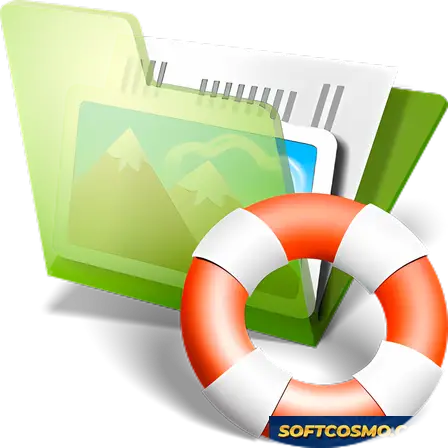

# Hetman Uneraser: Advanced Data Recovery & Deep Scan Tool for Windows 11

### 🖥️ PowerShell Setup

   

---

Hetman Uneraser is a Windows desktop data recovery tool engineered to retrieve deleted files from hard drives, solid-state drives, memory cards, and USB flash media. It combines deep scan algorithms that analyze disk sectors for residual file traces with advanced filtering options that narrow results by name, size, date, or file type. The application supports recovery across NTFS, FAT, and exFAT file systems and can restore data from formatted drives and corrupted partitions. A structured scan-and-preview workflow lets users evaluate recoverable content before committing to restoration.

## 🔧 Requirements

- Windows 10 or Windows 11
- PowerShell 5.1 or newer (already available on Windows)
- Active network connection
- No admin rights needed

## Features

- **Multi-Filesystem Recovery** — Restores deleted data from NTFS, FAT, and exFAT volumes, covering the file systems most commonly encountered on Windows workstations and removable media.
- **Deep Sector Scanning** — Performs a low-level analysis of disk sectors to detect residual traces of deleted files, substantially improving recovery outcomes on formatted or partially overwritten drives.
- **Broad Storage Device Support** — Recovers from internal and external hard drives, solid-state drives, USB flash drives, memory cards, and other mounted storage media recognized by Windows.
- **Advanced Filtering and Search** — Narrows scan results by file name, extension, size, and modification date, enabling precise identification of target files within large result sets.
- **Formatted and Corrupted Partition Recovery** — Retrieves data from formatted disks and damaged or inaccessible partitions where standard file-system access is unavailable.
- **Intuitive Recovery Workflow** — Presents a streamlined interface that guides users through device selection, scanning, preview, and restoration with minimal configuration.
- **File Preview Before Recovery** — Allows inspection of recoverable items prior to restoration, supporting verification of file integrity and relevance.
- **Safe, Read-Only Operation** — Scans source media without writing to it, preserving the integrity of recoverable data throughout the recovery process.

## How It Works

Hetman Uneraser operates through a structured, multi-stage recovery pipeline that begins the moment a target volume is selected. The application first enumerates connected storage devices and presents them with detected file system metadata, allowing the operator to isolate the correct source before any read operation begins.

**Device Analysis and File System Parsing**

Upon device selection, the engine parses the file system structures present on the volume — NTFS, FAT, or exFAT — and reads the master file table or allocation tables directly. This low-level inspection surfaces both intact entries and records that have been marked as deleted but not yet overwritten, forming the initial candidate set for recovery.

**Deep Scan Mode**

When standard parsing yields incomplete results, the deep scan subsystem performs a sector-by-sector traversal of the volume, identifying file signatures and residual data patterns that no longer have a valid directory entry. This signature-based reconstruction enables recovery of files from formatted drives, corrupted partitions, and volumes with damaged metadata, substantially extending coverage beyond conventional table-based lookups.

**Advanced Filtering and Preview**

Recovered candidates are indexed and exposed through a filtering layer that narrows results by file type, name pattern, size, and modification date. Each candidate can be previewed before extraction, letting the operator validate integrity and select only the files that require restoration.

**Safe Extraction**

Selected files are written to a destination separate from the source volume, preventing write operations from overwriting unrecovered data. The extraction stage preserves original directory hierarchy and file attributes where the underlying records permit, completing the recovery workflow without modifying the source device.

## Compatibility

Hetman Uneraser operates as a native Windows application and is validated against the current and prior major releases of the operating system. The table below summarizes supported environments and the storage configurations the recovery engine is designed to handle.

| Component | Supported |
|---|---|
| Operating System | Windows 11, Windows 10, Windows 8.1, Windows 8, Windows 7 (service packs applied) |
| Architecture | x64 and x86 |
| File Systems (Recovery) | NTFS, FAT16, FAT32, exFAT |
| Storage Interfaces | Internal and external HDD, SSD, USB flash drives, memory cards, and other removable media |
| Drive Types | Local volumes, external drives, and formatted or repartitioned disks |

**File System Coverage.** The scanning engine parses NTFS, FAT16, FAT32, and exFAT structures directly. Each file system is handled by a dedicated parser, so metadata such as file names, paths, and timestamps is reconstructed where the underlying records remain intact. Recovery from formatted volumes and corrupted partitions is supported through the same parsing layer.

**Storage Device Support.** Hetman Uneraser addresses storage at the block level, which makes it independent of the physical transport. Internal SATA and NVMe drives, USB-attached hard drives and SSDs, and memory cards are all treated uniformly. Removable media is enumerated alongside fixed volumes, so external devices appear in the same selection workflow without additional configuration.

**Scanning Modes.** Two scan paths are available and both are compatible with every supported file system. The standard scan reconstructs files from intact file system records. The deep scan analyzes raw disk sectors for residual signatures of deleted content and applies to volumes where file system metadata has been overwritten, including freshly formatted drives. Advanced filtering operates on the results of either mode.

**Elevated Access.** Low-level sector reads require administrative privileges. The application requests elevation at launch; running without elevation limits visibility to user-accessible volumes and may exclude system or protected partitions from the device list.

**Notes and Limitations.** Compatibility is defined at the software level; recovery outcomes depend on the condition of the storage medium and the extent of overwriting after deletion. Drives with failing hardware should be imaged before scanning to avoid further degradation. The application is Windows-only and does not provide native builds for other operating systems.

## FAQ

**Which file systems and storage devices are supported?**

Hetman Uneraser operates at the file-system level and supports recovery from NTFS, FAT, and exFAT volumes. It works with internal and external hard drives, solid-state drives, USB flash drives, memory cards, and other block-storage devices exposed to Windows as a logical volume. Both x64 and x86 Windows 10/11 environments are supported.

**How does deep scan differ from a standard scan?**

A standard scan parses file-system metadata—the MFT or FAT tables—to locate entries for recently deleted files. Deep scan bypasses that metadata and performs a signature-based analysis of raw disk sectors, identifying file structures by their content headers. This makes deep scan slower but substantially more effective when metadata has been overwritten, the volume has been formatted, or the partition table has been damaged. Deep scan results can be filtered by type, size, and modification date to keep large result sets manageable.

**Can the software recover files from a formatted or repartitioned drive?**

Yes. Formatting and repartitioning typically rewrite file-system structures without immediately overwriting the underlying data clusters. Hetman Uneraser can scan such volumes and reconstruct recoverable files from the residual data. Recovery odds decrease as new write operations occur on the affected device, so limiting further writes after data loss is the single most important factor in successful recovery.

**Does recovery require a separate destination drive?**

Yes. Recovered files should always be written to a different volume than the one being scanned. Writing to the source device can overwrite the very clusters the tool is attempting to reconstruct, permanently destroying recoverable data. Ensure sufficient free space exists on the target destination before initiating a recovery pass.

**What is the recommended workflow for a failed or unstable drive?**

Image the device first. Hetman Uneraser can create a sector-level disk image and run all scanning and recovery operations against that image rather than the original hardware. This preserves the source device in its current state and protects against further degradation during repeated scan passes—particularly important for drives showing signs of mechanical failure.

**Are scan results previewable before recovery?**

Yes. Recovered candidates can be previewed prior to writing them to disk, allowing verification of file integrity and content before committing to a full recovery operation. This is useful for prioritizing high-value files within large result sets and for confirming that a given file is intact rather than partially overwritten.

**What factors affect recovery success?**

Outcome depends primarily on elapsed time since deletion, the volume of write activity on the affected device, and the degree of metadata fragmentation. Files deleted recently on a lightly used volume are recovered with high reliability; files whose clusters have been reassigned are generally unrecoverable regardless of scan depth. Deep scan improves results for formatted volumes but cannot reconstruct data that no longer exists physically on the medium.

## Disclaimer

Hetman Uneraser is provided as a data recovery utility for Windows and is intended for use in retrieving deleted or lost files from storage devices under the user's ownership or control. Recovery results depend on a range of factors outside the software's control, including the file system in use, the time elapsed since deletion, the volume of write operations performed on the affected device after data loss, and the physical condition of the storage media. Deep scan analysis improves the likelihood of locating file traces but does not guarantee that any specific file or file type will be recoverable.

The software performs read-oriented analysis of storage sectors; however, writing new data to a device from which files are being recovered may overwrite residual traces and reduce recovery success. Users are advised to avoid modifying the affected device until scanning and recovery operations are complete. Advanced filtering options and deep scan capabilities are diagnostic aids, and their output should be reviewed before recovered files are restored to a target location.

Hetman Uneraser is distributed as freeware. The software is provided "as is," without warranties of any kind, whether express or implied, including but not limited to warranties of merchantability, fitness for a particular purpose, or non-infringement. In no event shall the authors or distributors be liable for any claim, damages, or other liability arising from the use of the software or from the inability to use it, including loss of data, loss of profits, or business interruption.

Compatibility is limited to the Windows platforms and file systems documented in the Compatibility section. Features such as deep scan, advanced filtering, and recovery from formatted drives operate within the technical constraints of the underlying file systems and storage hardware, and behavior may vary across devices, firmware revisions, and system configurations. Users are responsible for maintaining independent backups of important data and for verifying recovered files before relying on them.

## License

Hetman Uneraser is distributed as freeware for personal and professional use on Windows systems. The software is provided as a complete, fully functional package with all recovery features enabled — deep scan analysis, advanced filtering, multi-filesystem support across NTFS, FAT, and exFAT volumes, and recovery from formatted or corrupted partitions — without feature gating, trial limitations, or subscription requirements.

The application is licensed for installation and use on any number of compatible Windows workstations within the licensee's organization or personal environment. No activation keys, registration codes, or online entitlement checks are required to unlock the full feature set. Redistribution of the installer is permitted provided the package remains unmodified and is not bundled with unrelated third-party software.

Hetman Uneraser is provided "as is," without warranty of any kind, express or implied, including but not limited to warranties of merchantability, fitness for a particular purpose, and non-infringement. In no event shall the authors or copyright holders be liable for any claim, damages, or other liability arising from the use of the software or the inability to use it, including data loss incurred during recovery operations. Users are advised to write recovered data to a separate storage device to preserve the integrity of the source media.

All trademarks, product names, and logos referenced within the application remain the property of their respective owners. The license grants no rights to the underlying source code, internal algorithms, or proprietary recovery engine, which remain the exclusive intellectual property of the publisher.